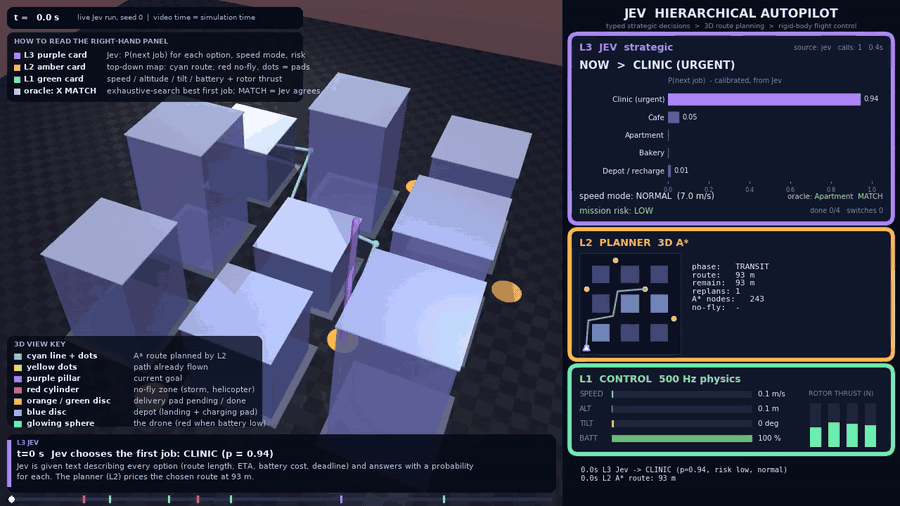
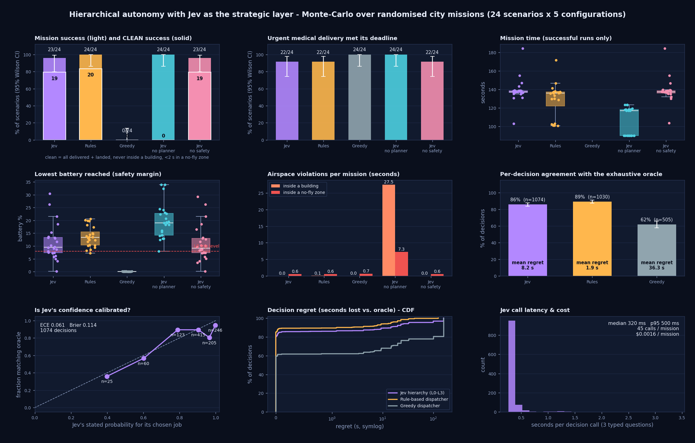
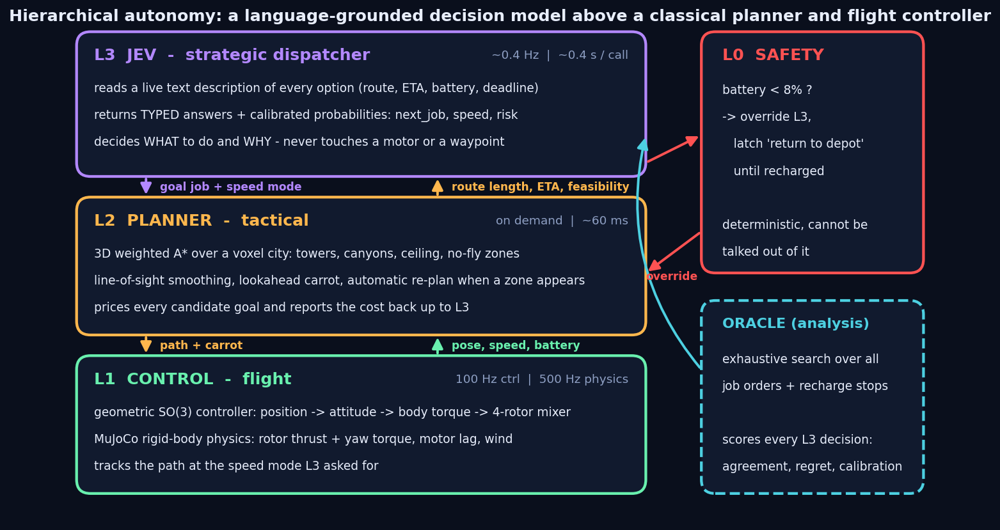
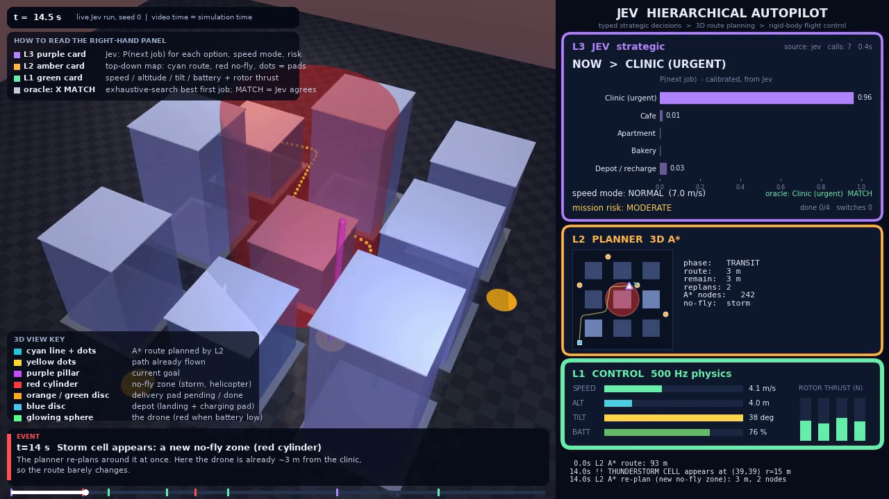

# Jev Hierarchical Planner

**A typed-decision model flies a drone.** Jev decides *what to do*, an A\* planner decides *where to fly*, and a physics-based controller decides *how to fly it*.


-b388ff?style=flat-square)




*Annotated live run, seed 0, first 24 s. Full 104 s video: [`docs/demo.mp4`](docs/demo.mp4). Every overlay is explained in [What the video shows](#what-the-video-shows).*

---

## Contents

1. [Why Jev?](#why-jev)
2. [Results](#results)
3. [What the analytics found](#what-the-analytics-found)
4. [Cost and speed versus general-purpose LLMs](#cost-and-speed-versus-general-purpose-llms)
5. [Related work](#related-work)
6. [How it works](#how-it-works)
7. [What the video shows](#what-the-video-shows)
8. [The math](#the-math)
9. [Run it](#run-it)
10. [Tests](#tests)
11. [Caveats](#caveats)
12. [References](#references)

---

## Why Jev?

Planners and flight controllers are good at geometry and dynamics. They are bad at the **judgment layer**: choosing between competing goals under constraints stated in words, such as a medical deadline, a battery reserve or a hazard.

Jev is a hosted "System One" model built for that slot [[1]](#references) [[2]](#references). You give it a block of text describing the situation and a set of typed questions. It returns typed answers (`choice`, `score`, or yes/no `noul`) with a probability for every option, and no prose.

### What Jev provided in this project

**1. Machine-checkable outputs.** The answer is always one of the options supplied, so nothing has to be parsed.
- *Evidence:* 0 API failures or fallbacks across 5,727 calls in 144 Jev-driven missions.
- *Caveat:* my client silently repairs an out-of-set choice (it takes the highest-probability option), and I did not log whether that ever happened. A valid answer is also not a correct one: 86 % oracle agreement, and one held-out mission ended in a crash.

**2. Probabilities you can act on.** Every option carries a probability, and the mission loop uses it: it only switches jobs when a challenger beats the current job by 0.15.
- *Evidence:* confidence is roughly calibrated against an exhaustive-search oracle (ECE 0.061, Brier 0.114).
- *Caveat:* overconfident in the 0.95 to 0.99 bin (about 80 % agreement). The oracle is a proxy for ground truth, not ground truth.

**3. Latency and cost that fit inside a control loop.**
- *Evidence:* median 320 ms and p95 500 ms per call on the held-out missions; about \$0.000035 per call and \$0.0016 per mission (45 calls).
- *Caveat:* no LLM was benchmarked here. The comparison in [Cost and speed](#cost-and-speed-versus-general-purpose-llms) uses published prices and vendor-reported latency.

**4. A policy written in language.** The dispatch rules are a paragraph of English, not code.
- *Evidence:* fixing the v1 failures meant reordering one sentence of the prompt (see [What the analytics found](#what-the-analytics-found)).
- *Caveat:* the flip side is that behaviour is sensitive to wording, and that sensitivity caused the v1 failures.

**5. Grounded by tools instead of replacing them.** The planner prices every option, and those prices go into Jev's prompt.
- *Evidence:* without the A\* planner the drone spent 27.5 s per mission inside buildings (0/24 clean successes).
- *Caveat:* Jev does not plan routes and was never asked to.

### Where Jev sits next to the alternatives (for this task)

| approach | good at | cost here |
|---|---|---|
| Hand-written rules | **best results here** (24/24), free, deterministic | every new constraint is a code change; no uncertainty output |
| Exhaustive search (the oracle) | optimal for a fully specified model | needs the whole problem formalised; factorial in the number of jobs; used here only offline, for scoring |
| General LLM agent (free text) | flexible; can explain itself | costlier per decision at published prices; output must be parsed unless structured outputs are used; latency **not measured here** |
| **Jev** | typed, probability-scored, fast, specified in language | no rationale text (a gap for audits) [[1]](#references); alpha hosted endpoint; vendor claims not independently verified |

### What the results mean

- **A paragraph of English matched hand-engineered code.** Jev completed 23/24 missions against 24/24 for a hand-tuned dispatcher, a statistical tie. It did this with no task-specific code: the whole dispatch policy is one paragraph of text.
- **Close to optimal.** In 86 % of decisions Jev picked the same next job as an exhaustive search over every possible plan. When it differed, it lost 8.2 s on average.
- **It knows when it is unsure.** Its stated confidence tracks its accuracy (ECE 0.061), so a system can trust its confident calls and route the uncertain ones elsewhere.
- **Changing the policy is a one-sentence edit.** The v1 failures were fixed by reordering one sentence, with no code change and no retraining.

### Why this matters, and the next experiment

Hand-coded decision logic is brittle: every new situation needs an engineer to anticipate it and write a rule. That long tail of unanticipated cases is one of the hardest problems in autonomous vehicles. These results point at a different route: a fast, calibrated decision model that reads the situation as text, matches hand-engineered logic on the cases the engineers did anticipate, and is changed by editing language.

The decisive test is still ahead. In these scenarios every constraint was numeric, which is home ground for hand-coded rules, so parity is the strongest result available here. The case where Jev should pull ahead is **constraints that arrive as free text that no rule author anticipated** ("a crowd has gathered outside the bakery", "the depot pad is blocked"). Running that comparison is the natural next step.

**Room to improve:** Jev never chose the `urgent` speed mode, even when a deadline was tight, and averaged about 8.5 s slower per mission than the hand-tuned dispatcher.

---

## Results

> **TL;DR**
>
> - **The hierarchy works.** Over 24 held-out randomised city missions, Jev as the strategic layer delivered all 4 packages and landed in **23/24**. A greedy dispatcher with no battery look-ahead managed **0/24**.
> - **Jev matches a hand-engineered dispatcher with no task-specific code.** Given the same numbers, the hand-tuned rules went 24/24 against Jev's 23/24, a statistical tie. Jev picked the exhaustive-search optimum in **86 %** of decisions (rules: 89 %, not significance-tested), at a cost of about 8.5 s per mission. Jev's whole policy is one paragraph of English.
> - **Jev's confidence is usable.** Its probabilities roughly track how often it agrees with the exhaustive-search oracle (**ECE 0.061**), with some overconfidence in the 0.95 to 0.99 bin.
> - **The planner and a battery-aware strategist earn their place; L0 is untested.** Without the planner the drone "succeeds" 24/24 but flies through buildings for 27.5 s per mission (0/24 clean). Greedy runs out of power every time. The L0 safety supervisor never triggered, so these runs say nothing about its value.
> - **The analytics caught a real bug.** v1 scored 21/24 because my prompt ranked the deadline above battery safety. After the fix, a re-run on *different, held-out* seeds scored 23/24 (so this is not a controlled before/after).
> - **Cheap.** About **\$0.0016 per mission**, and \$0.197 for both full campaigns (5,727 Jev calls). No GPU needed.

### Setup

- **Randomised per seed:** storm and no-fly timing, size and position; the medical deadline; start battery (72 to 100 %); wind.
- **Paired:** every configuration flies the *same* scenario for a given seed.
- **Held out:** seeds 25 to 48 were not looked at while the prompt was being fixed. Seed 0 is the demo scenario used during development and is not in any statistic.

| term | meaning |
|---|---|
| **success** | all 4 deliveries made **and** the drone landed at the depot without running out of battery |
| **clean success** | success **and** never inside a building **and** under 2 s inside a no-fly zone (zones can appear around the drone) |
| **oracle agreement** | fraction of decisions whose chosen first job is optimal under exhaustive search, or within 0.75 s of it |
| **regret** | seconds lost versus the oracle's best plan for the chosen first job (capped, with an extra penalty if no feasible plan starts with it) |

### Main table (held-out seeds 25 to 48)

| configuration | success | clean success | deadline met | time (s) | oracle agreement | mean regret | cost / mission |
|---|---|---|---|---|---|---|---|
| **Jev hierarchy (L0 to L3)** | 23/24 (96 %) | 19/24 | 22/24 | 139 | 86 % | 8.2 s | \$0.0016 |
| Rule-based dispatcher | 24/24 (100 %) | 20/24 | 22/24 | 129 | 89 % | 1.9 s | - |
| Greedy dispatcher | **0/24** | 0/24 | 24/24 | - | 62 % | 36.3 s | - |
| Jev, **no A\* planner** | 24/24 | **0/24** | 24/24 | 106 | - | - | \$0.0012 |
| Jev, no L0 safety | 23/24 | 19/24 | 22/24 | 138 | 85 % | 8.5 s | \$0.0016 |

Time is the mean over successful runs. Confidence intervals and paired tests are in [`docs/RESULTS.md`](docs/RESULTS.md).



### Reading the figure

- **Success (light) vs clean success (solid):** separates "finished" from "finished without cheating". The no-planner ablation shows the big gap.
- **Airspace violations:** shows that cheat directly, 27.5 s inside buildings and 7.3 s in no-fly zones per mission.
- **Lowest battery:** the safety margin each policy leaves; greedy hits 0 %.
- **Oracle agreement and regret:** every decision scored against exhaustive search.
- **Calibration:** the reliability diagram; points on the dashed diagonal mean "confidence = accuracy".
- **Regret CDF:** most decisions cost 0 s; the tail is where Jev loses time.

### What the numbers say, and what they don't

- **Jev vs rules:** success is a statistical tie (23/24 vs 24/24, sign test p = 1.0). On the 23 seeds where both finished, Jev was slower in 20 and faster in 1: on average 8.5 s slower (95 % CI 1.8 to 15.8 s).
- **The `urgent` speed mode was never used,** even on the two seeds that missed the deadline. Seed 30 was missed by both Jev and the rules dispatcher; on seed 31 only Jev was late, by 2.2 s. This is a real gap in how Jev trades battery against time.
- **L0 is a null result.** It never triggered in Jev's runs, and the one Jev crash (seed 35) happened with L0 switched on. An 8 % trip level is too late when the drone is far from the depot; a distance-aware trip level would fix that.

---

## What the analytics found

| | v1 (seeds 1 to 24) | v2 (seeds 25 to 48, held out) |
|---|---|---|
| **Prompt priority** | 1. hard-deadline delivery, 2. battery | 1. **battery safety (hard constraint)**, 2. deadline |
| **Jev success** | 21/24 (88 %) | 23/24 (96 %) |
| **Rules success** | 23/24 (96 %) | 24/24 (100 %) |
| **Jev calibration (ECE)** | 0.128 | 0.061 |

**What went wrong in v1.** All three v1 Jev failures had the same shape: a low start battery (about 79 %), Jev flew the urgent medical run to the far corner, and the drone died before it could get home. The cause was my prompt, not the model. The prompt listed the deadline as priority 1 and battery as priority 2, and Jev followed it.

**The fix.** I made battery safety a hard constraint and re-evaluated on **fresh seeds** rather than the same ones, so the fix is not tuned on its own test set. v1 is archived in [`docs/v1/`](docs/v1/).

> **Read the table as direction, not effect size.** v1 and v2 use different scenarios, so this is not a controlled before/after: the rules baseline also moved from 96 % to 100 % purely from the scenario draw, and the ECE change could come from the seeds as much as from the prompt. The stronger evidence is qualitative: all three v1 failures had one identical cause that traces directly to the prompt wording. A controlled test (re-running the fixed prompt on seeds 1 to 24) was not done.

---

## Cost and speed versus general-purpose LLMs

**This is a calculation, not a benchmark.** I chose not to spend API money on an LLM head-to-head, so the LLM side uses published prices and vendor-reported latency. Every number can be reproduced with [`scripts/cost_compare.py`](scripts/cost_compare.py).

### Basis

- **Measured here (Jev):** 44.8 calls per mission, \$0.000035 per call, \$0.0016 per mission, median 0.32 s and p95 0.50 s, over the 24 held-out missions. About 840 input tokens per call, inferred from the billed cost and the published price of \$0.042 per million input tokens (output is free) [[1]](#references).
- **Assumed (LLM):** the same ~840-token prompt, and either 100 output tokens (a short JSON answer) or 1,000 (modest reasoning). Prices are OpenRouter list prices retrieved on 2026-10-02 [[17]](#references); providers and tiers vary by roughly 2x.
- **"Frontier average":** the mean price of four flagships I picked (Claude Opus 5.5, Claude Sonnet 5.5, GPT-6.1 Sol, Grok 4.7), which is \$2.50 in and \$11.50 out per million tokens. "Frontier" is my judgment.
- **Not measured:** LLM latency and LLM decision quality.

### Cost per decision and per mission

| model (list price in / out, per M tokens) | cost per call | cost per mission | vs Jev |
|---|---|---|---|
| **Jev (measured)** | \$0.000035 | \$0.0016 | 1x |
| ***Short JSON answer: 100 output tokens*** | | | |
| Frontier average (\$2.50 / \$11.50) | \$0.00325 | \$0.1453 | 92x |
| claude-opus-5.5 (\$4 / \$20) | \$0.00535 | \$0.2396 | 152x |
| claude-sonnet-5.5 (\$2 / \$10) | \$0.00268 | \$0.1198 | 76x |
| gpt-6.1-sol (\$2 / \$10) | \$0.00268 | \$0.1198 | 76x |
| grok-4.7 (\$2 / \$6) | \$0.00228 | \$0.1019 | 65x |
| gemini-3.8-flash (\$0.75 / \$3.75) | \$0.00100 | \$0.0449 | 29x |
| gpt-6-luna (\$0.1 / \$0.5) | \$0.00013 | \$0.0060 | 4x |
| deepseek-v4-flash (\$0.028 / \$0.056) | \$0.00003 | \$0.0013 | 1x |
| ***Modest reasoning: 1,000 output tokens*** | | | |
| Frontier average (\$2.50 / \$11.50) | \$0.01360 | \$0.6084 | 386x |
| claude-opus-5.5 (\$4 / \$20) | \$0.02335 | \$1.0451 | 663x |
| claude-sonnet-5.5 (\$2 / \$10) | \$0.01168 | \$0.5225 | 332x |
| gpt-6.1-sol (\$2 / \$10) | \$0.01168 | \$0.5225 | 332x |
| grok-4.7 (\$2 / \$6) | \$0.00768 | \$0.3435 | 218x |
| gemini-3.8-flash (\$0.75 / \$3.75) | \$0.00438 | \$0.1960 | 124x |
| gpt-6-luna (\$0.1 / \$0.5) | \$0.00058 | \$0.0261 | 17x |
| deepseek-v4-flash (\$0.028 / \$0.056) | \$0.00008 | \$0.0036 | 2x |

- **Against the frontier average,** the same decisions cost roughly **90x** more with a short JSON answer, and roughly **390x** more once the model spends 1,000 tokens reasoning.
- **Price alone is not Jev's edge against cheap models.** Gemini 3.8 Flash is about 29x Jev's cost, GPT-6 Luna about 4x, and DeepSeek V4 Flash at its cheapest listed tier is about the same as Jev for a short answer. Whether those cheap models decide as well as Jev here is untested.

### Latency

| decision latency | per call | decision time per mission | distance flown at 7 m/s while waiting for one decision | speed-up vs Jev |
|---|---|---|---|---|
| **Jev, measured median** | 0.32 s | 14 s | 2.2 m | 1x |
| Jev, measured p95 | 0.50 s | 22 s | 3.5 m | - |
| LLM, vendor-reported low end | 3 s | 134 s | 21 m | 9x |
| LLM, vendor-reported high end | 30 s | 1,342 s | 210 m | 94x |

- **Speed-up of about 9x to 94x,** but only because the LLM figures (3 to 30 s) are the vendor's own, as summarised in [[1]](#references). They were not measured here, and the vendor's headline claim of 40x to 200x is not reproduced. A small fast model giving a short JSON answer can plausibly respond in well under 3 s, in which case the real speed-up would be below 9x.
- **Why latency matters in this loop.** The mission asks for a decision every 2.5 s. With a 3 s LLM, the decisions alone would add up to about 134 s, longer than the whole 104 s mission. The loop would have to run asynchronously on stale decisions, each 3 to 30 s old: **21 to 210 m of flight at 7 m/s**, against 2.2 m for Jev. "Decision time per mission" is total waiting, not extra mission time.

### What this comparison leaves out

- **Quality.** The vendor's own benchmark has Jev a few points behind the top LLMs (67.8 % against 73 to 74 %, as summarised in [[1]](#references)), and a general LLM can explain its choice, which Jev cannot. This repo measures Jev's decision quality against an oracle but does not measure any LLM's.
- **Typed output is not unique to Jev.** Many of these models advertise structured-output support on OpenRouter, so a valid-option guarantee is available to LLMs too. The difference is that Jev's per-option probabilities are a native output, whereas an LLM's would be token log-probabilities or self-reported confidence [[16]](#references).
- **Prompt caching.** Most of the prompt is a stable block of questions, so LLM input cost with caching could be well below the figures above. I did not model it.
- **Prices drift.** Treat the multiples as a snapshot.

The natural next step, not done here, is to send the captured decision prompts to the same models and time them.

---

## Related work

None of these systems were re-run here. The comparison is about design, not benchmark numbers, and the tasks differ.

- **SayCan** (Ahn et al. 2022) [[3]](#references). A language model proposes natural-language skills, and learned value functions of pretrained skills constrain the choice to what is feasible.
  *Here:* the same idea of grounding a language-side choice in feasibility, but the grounding is a classical planner's route cost written into the prompt as numbers, and the selector returns per-option probabilities directly.
- **Code as Policies** (Liang et al. 2022) [[12]](#references). A code-writing language model synthesises executable Python that calls robot control APIs.
  *Here:* no code is generated or executed at run time. The strategic model can only pick among enumerated options, which limits both what it can do and what it can break.
- **TypeFly** (Chen et al. 2023) [[13]](#references). An LLM writes drone control plans in a small custom language (MiniSpec), designed because generation latency grows with the length of the output plan.
  *Here:* also a drone, but the model returns a fixed-size typed answer instead of a plan program, so latency does not grow with plan length. Flexibility is correspondingly lower: the options are fixed in advance.
- **LLM+P** (Liu et al. 2023) [[14]](#references). The LLM translates a problem into PDDL and a classical planner solves it optimally.
  *Here:* for a fully formalised problem like this one, formalise-and-solve is the stronger approach. The exhaustive-search oracle is exactly that, and it is optimal by construction. A model like Jev only makes sense in this slot when constraints cannot be fully formalised, which this project does not test.
- **PlanBench** (Valmeekam et al. 2022) [[4]](#references). A benchmark showing that LLMs struggle to plan about actions and change.
  *Here:* the motivation for keeping route geometry in A\* rather than asking the strategic model to plan.
- **KnowNo** (Ren et al. 2023) [[15]](#references). Conformal prediction over an LLM's option-confidence scores yields a prediction set, and the robot asks for help when the set has more than one option.
  *Here:* the same use for option probabilities. This project uses them only for switching hysteresis and measures calibration (ECE), but gives no coverage guarantee. A KnowNo-style conformal wrapper around Jev's probabilities is an obvious next step, **not done here**.
- **Calibration of language models** (Kadavath et al. 2022 [[5]](#references); Tian et al. 2023 [[16]](#references)). Large models can be well calibrated on multiple-choice questions posed in the right format; for RLHF models, verbalised confidence is often better calibrated than raw token probabilities.
  *Here:* confidence is a first-class typed output rather than something elicited by prompting, and it is scored against an oracle on the actual decision problem.
- **Three-layer architectures** (Gat 1998) [[11]](#references). The classical split of an autonomous robot into deliberation, sequencing and reactive control.
  *Here:* the L3 / L2 / L1 split follows this pattern. **The architecture is not new**; what is new is the kind of model in the deliberative slot.

### What this project adds, and what it does not

- **A typed, probability-returning model in the strategic slot,** rather than generated text, code or a plan program, with each decision scored individually.
- **A closed loop with the planner.** The planner prices every option and those prices are written into the prompt, so goal choices use up-to-date route length, ETA and battery cost.
- **An evaluation harness aimed at the strategic layer.** An exhaustive-search oracle gives each decision a regret and an agreement label; scenarios are randomised and paired across configurations, with held-out seeds; and ablations use a "clean success" metric that exposes shortcuts, such as flying through buildings, which plain success hides. I did not survey how the papers above evaluate, so I make no claim that this is unusual.
- **Parity with hand-engineered code, measured carefully:** a statistical tie with a hand-tuned dispatcher on numeric constraints, plus a failure mode traced to prompt wording and fixed with a one-sentence edit.
- **No claim of novelty beyond that.** The hierarchy, the grounding idea and the use of calibrated option probabilities all have clear precedents above.

---

## How it works



| layer | rate | decides | code |
|---|---|---|---|
| **L3 Jev** | about 0.4 Hz, ~0.35 s per call | which job next, speed mode, mission risk | [`strategist.py`](jevplanner/strategist.py) |
| **L2 planner** | on demand, ~60 ms | the 3D route through towers, canyons, the ceiling and no-fly zones | [`planner.py`](jevplanner/planner.py) |
| **L1 control** | 100 Hz control, 500 Hz physics | rotor thrusts that track the route | [`physics.py`](jevplanner/physics.py) |
| **L0 safety** | every tick | forces "return to depot" at low battery | [`mission.py`](jevplanner/mission.py) |
| **Oracle** | analysis only | scores every L3 decision by exhaustive search | [`oracle.py`](jevplanner/oracle.py) |

**The closed loop.** Jev picks goals; the planner prices them. Every ~2.5 s Jev receives a text description of the world and three typed questions, and answers each with a probability per option:

```text
next_job : choice   options rebuilt each call from the planner's live numbers, e.g.
                    "Deliver URGENT medical supplies to the Clinic. Planned route 141 m, ETA 27 s,
                     uses ~47% battery, leaving ~32%; a further ~38% is then needed to fly home.
                     HARD DEADLINE in 31 s."
speed    : choice   eco | normal | urgent
risk     : score    low | moderate | high | critical
```

The chosen job goes down to the planner, which builds a 3D route. The controller flies it. Route length, ETA and battery cost for every option flow back up into the next prompt.

---

## What the video shows

The video is one live run (seed 0). Jev makes 35 decisions, the planner builds 8 routes, and the drone delivers four packages and lands. **Video time equals simulation time.** The overlays are burned in by [`scripts/annotate_video.py`](scripts/annotate_video.py) from the recorded run, with no re-simulation.



### Overlays

| overlay | what it tells you |
|---|---|
| **Clock and timeline bar** (top-left, bottom) | Current time. Coloured ticks mark events: purple = a Jev decision, red = a no-fly zone appears, green = a package delivered. |
| **"How to read the right-hand panel"** (top-left) | Key to the three HUD cards: purple L3 = Jev's probabilities, amber L2 = planner map, green L1 = flight telemetry. |
| **"3D view key"** (bottom-left) | Cyan line = A\* route; yellow dots = trail flown; purple pillar = current goal; red cylinders = no-fly zones; orange / green discs = delivery pads pending / done; blue disc = depot; glowing sphere = the drone. |
| **Caption banner** (bottom) | What is happening now, tagged by layer: L3 Jev, L2 planner, L1 control, or EVENT. |
| **HUD line "oracle: X MATCH"** | The exhaustive-search best first job; MATCH means Jev's choice agrees with it. |

### Timeline of this run

All values come from the run's own log.

| time (s) | layer | what happens |
|---|---|---|
| 0.0 | L3 | Jev picks **Clinic** first (p = 0.94); L2 prices the route at 93 m |
| 3 to 14 | L2 / L1 | The drone follows the A\* route through the street canyons at 7 m/s |
| 14.0 | event | **Storm cell** appears (red cylinder) and A\* re-plans. The drone is already ~3 m from the clinic, so little changes |
| 16.5 to 19.0 | L1 | Hovers over the Clinic pad and drops the package (the deadline was 60 s) |
| 19.0 | L3 | Jev picks **Bakery** with **low confidence (p = 0.30)**; 48 m route |
| 30.4 | L3 | Jev picks **Cafe** (p = 0.56) and speed mode **ECO** (4.5 m/s) |
| 36.0 | event | **Helicopter no-fly zone** appears; A\* re-plans a 21 m route to the Cafe |
| 42.3 | L3 | Jev sends the drone home to **recharge** (Depot, p = 0.97) |
| 57.6 | L1 | Lands with **7 % battery**. L0's trip level is 8 %, but the drone was already returning, so L0 never fired. A thin margin |
| 57.6 to 63.6 | L1 | Recharging, motors off; the pad restores 100 % |
| 63.6 | L3 | Jev picks **Apartment** (p = 0.73), speed NORMAL; 100 m route |
| 83.3 | L3 | All four delivered; Jev sends the drone home (p = 1.00) |
| 104.0 | L1 | **Mission complete:** 4/4 delivered, 0 s inside a building, 1.1 s inside a no-fly zone |

Notes on the run:

- The same 1.1 s of no-fly time shows up for every policy on this seed in my runs, which points at a zone appearing on top of the drone rather than a routing error. I did not trace it.
- Captions describe only what is observable. Jev returns probabilities, not reasons, so the video never claims *why* it chose something.
- Oracle agreement for this particular run was 86 %.

---

## The math

Symbols are defined in the text around each equation. Constants match the code.

### L2 planning: weighted A\* on a voxel grid

The city is a voxel grid with resolution *r* = 2 m. A voxel at (*x*, *y*, *z*) is **blocked** if it is at ground level, inside any building, or inside any active no-fly zone. Buildings are inflated by a margin *m* = 2.5 m horizontally and 2 m vertically. Building *b* has centre (*c*<sub>x</sub>, *c*<sub>y</sub>), half-widths *h*<sub>x</sub>, *h*<sub>y</sub> and height *H*; no-fly zone *k* has centre *c*<sup>k</sup> and radius *R*<sub>k</sub>.

Blocked by building *b*:

$$
|x-c^{b}_{x}| \lt h^{b}_{x}+m \quad\text{and}\quad |y-c^{b}_{y}| \lt h^{b}_{y}+m \quad\text{and}\quad z \lt H_{b}+2
$$

Blocked by active no-fly zone *k* (a vertical cylinder):

$$
(x-c^{k}_{x})^{2}+(y-c^{k}_{y})^{2} \lt (R_{k}+m)^{2}
$$

Moving to a neighbouring voxel (26-connected) costs its distance, with vertical motion weighted 1.6x, plus a penalty for hugging obstacles:

$$
c(u \to v) = r\sqrt{\Delta x^{2}+\Delta y^{2}+(1.6 \Delta z)^{2}} \quad +\quad 0.7 r\cdot\mathbf{1}\big[ v \text{ is next to an obstacle} \big]
$$

The search inflates its heuristic by *w* = 1.25, which makes it **weighted A\*** [[8]](#references). Because the heuristic never overestimates the true cost, the path found costs at most 1.25 times the optimum:

$$
f(v) = g(v) + w h(v), \qquad h(v) = r\sqrt{\Delta x^{2}+\Delta y^{2}+(1.6 \Delta z)^{2}}, \qquad w = 1.25
$$

Waypoints are then **string-pulled** (greedy line-of-sight shortcuts). The drone tracks a "carrot" point a distance ℓ ahead of its projection onto the path, and a braking limit brings it to rest at the goal (*d* is the remaining path length):

$$
\ell = \operatorname{clip}\left(0.6 v_{\text{mode}},\ 3,\ 6\right)\ \text{m}, \qquad v_{\text{lim}} = \min\left(v_{\text{mode}},\ \sqrt{2\cdot 1.4\cdot d}+0.7\right)
$$

### L1 control: geometric controller on SO(3)

The structure follows the geometric quadrotor controller of Lee, Leok and McClamroch [[7]](#references). The position error **e** is shortened so the commanded speed saturates at *v*<sub>lim</sub>; a PD law then gives the desired acceleration, with tilt limited to 38°:

$$
\mathbf{a} = K_{p} \operatorname{clip}\left(\mathbf{e},\ \frac{v_{\text{lim}}K_{d}}{K_{p}}\right) - K_{d} \mathbf{v}, \qquad \mathbf{a}_{\text{des}} = \mathbf{a} + g \mathbf{e}_{3}, \qquad \lVert \mathbf{a}_{xy} \rVert \le g\tan 38^{\circ}
$$

The thrust direction fixes the desired attitude:

$$
\mathbf{z}_{b} = \frac{\mathbf{a}_{\text{des}}}{\lVert \mathbf{a}_{\text{des}} \rVert}, \qquad R_{d} = \left[\mathbf{x}_{b}\quad \mathbf{y}_{b}\quad \mathbf{z}_{b}\right]
$$

Collective thrust *T* and body torque **τ** follow, where *R* is the current attitude, **ω** the body rate and *J* the inertia:

$$
T = m \mathbf{a}_{\text{des}}\cdot R \mathbf{e}_{3}, \qquad \mathbf{e}_{R} = \tfrac{1}{2}\left(R_{d}^{\top}R - R^{\top}R_{d}\right)^{\vee}, \qquad \boldsymbol{\tau} = J\left(-K_{R} \mathbf{e}_{R} - K_{\omega} \boldsymbol{\omega}\right) + \boldsymbol{\omega}\times J\boldsymbol{\omega}
$$

The X-configuration mixer finds four rotor thrusts *f*<sub>i</sub> that produce *T* and **τ**. Rotor *i* sits at (*x*<sub>i</sub>, *y*<sub>i</sub>) with arm 0.2 m and spin direction *s*<sub>i</sub> = ±1; *k* = 0.016 is the yaw coefficient:

$$
T = \sum_{i=1}^{4} f_{i}, \qquad \tau_{x} = \sum_{i=1}^{4} y_{i} f_{i}, \qquad \tau_{y} = -\sum_{i=1}^{4} x_{i} f_{i}, \qquad \tau_{z} = k\sum_{i=1}^{4} s_{i} f_{i}
$$

Each rotor follows its command with first-order lag:

$$
\dot{f}_{i} = \frac{f^{\text{cmd}}_{i} - f_{i}}{\tau_{m}}, \qquad \tau_{m} = 30\ \text{ms}, \qquad 0 \le f_{i} \le 8\ \text{N}
$$

Gains: *K*<sub>p</sub> = 6, *K*<sub>d</sub> = 4, *K*<sub>R</sub> = 60, *K*<sub>ω</sub> = 10. Physics runs at 500 Hz in MuJoCo [[9]](#references); the controller runs at 100 Hz.

### Battery model and the feasibility rule

Battery *B* (in %) drains in proportion to total rotor thrust. Hovering, the rotors sum to about *mg* ≈ 14.7 N, so the drain is about 1.5 %/s:

$$
\dot{B} = -0.105\sum_{i=1}^{4} f_{i} \qquad [\text{percent per s}]
$$

For decisions, a leg with planned length *L* (metres) is priced as:

$$
\text{ETA} = \frac{L}{6} + 3\ \text{s}, \qquad \text{need} = 1.75 \times \text{ETA}\quad [\text{percent}]
$$

A job *j* is **feasible** only if it leaves enough battery to fly home plus a 10 % reserve, where home(*j*) is the planner's own cost of the route from the job back to the depot:

$$
B - \text{need}(j) - \text{home}(j) \ge 10\ \text{percent}
$$

L0 overrides everything and latches "return to depot" when *B* drops below 8 %.

### Oracle, regret and calibration

For the *n* remaining jobs, the oracle enumerates every ordering π (with optional recharge stops) and finds the fastest feasible plan:

$$
T^{\ast} = \min_{\pi \in S_{n},\ \text{recharge stops}} T(\pi) \qquad \text{subject to the battery and deadline constraints}
$$

A dispatcher that picks first job *c* has **regret**, in seconds:

$$
\rho(c) = T^{\ast}(\text{first} = c) - T^{\ast}
$$

Regret is capped, with an extra penalty if no feasible plan starts with *c*. A decision "agrees" with the oracle if *c* is optimal or ρ(*c*) is under 0.75 s.

Calibration uses Jev's stated probability *p*<sub>i</sub> for each chosen job and the outcome *y*<sub>i</sub> = 1 if the oracle agrees, else 0. Over *N* decisions grouped into *B* confidence bins, with *n*<sub>b</sub> decisions, accuracy acc<sub>b</sub> and mean confidence conf<sub>b</sub> in bin *b*, the expected calibration error [[6]](#references) and Brier score are:

$$
\text{ECE} = \sum_{b=1}^{B}\frac{n_{b}}{N} \big| \text{acc}_{b} - \text{conf}_{b} \big|, \qquad \text{Brier} = \frac{1}{N}\sum_{i=1}^{N}\left(p_{i} - y_{i}\right)^{2}
$$

Success rates carry 95 % **Wilson** score intervals [[10]](#references), for an observed rate p̂ over *n* trials with *z* = 1.96:

$$
\tilde{p} = \frac{\hat{p} + \frac{z^{2}}{2n}}{1 + \frac{z^{2}}{n}}, \qquad \text{interval} = \tilde{p} \pm \frac{z}{1 + \frac{z^{2}}{n}}\sqrt{\frac{\hat{p}(1-\hat{p})}{n} + \frac{z^{2}}{4n^{2}}}
$$

Paired comparisons use an exact two-sided **sign test** on the per-seed wins and losses:

$$
p_{\text{sign}} = \min\left(1,\ 2\sum_{i=0}^{k}\binom{n}{i}2^{-n}\right), \qquad k = \min(\text{wins},\ \text{losses}), \qquad n = \text{wins} + \text{losses}
$$

---

## Run it

```bash
python -m venv .venv && .venv/Scripts/pip install -r requirements.txt   # Windows; use .venv/bin/ on Linux
echo OPENROUTER_API_KEY=sk-or-... > .env                                 # .env is git-ignored; never commit it

python run_demo.py                   # live Jev, seed 0 -> out/demo.mp4, out/summary.png, out/decision_log.json
python run_demo.py --policy rules    # offline hand-written dispatcher, no API key needed
python rollout.py --seeds 1-24 --workers 6                       # Monte-Carlo (resumable, one JSON per rollout)
python analyze.py                                                 # -> docs/analysis.png, docs/RESULTS.md
python scripts/annotate_video.py out/demo.mp4 docs/demo.mp4       # burn in the explanatory overlays
```

- **Cost:** one Jev call (3 typed questions) is about \$0.000035 and ~0.35 s. A mission is ~45 calls, about \$0.0016. Each 120-rollout campaign (72 Jev missions) cost about \$0.10.
- **Hardware:** rollouts are CPU and API bound; **a GPU is not used**. On a Linux VM: `bash scripts/vm_rollout.sh 1-96 8`. Finished rollouts are skipped, so spot pre-emption is harmless.
- **Video captions** in `scripts/annotate_video.py` are tied to the recorded seed-0 run. If you re-record, update the `CAPTIONS` list.

### Layout

```text
jevplanner/   world.py (city, jobs, zones)      planner.py (A*)        physics.py (MuJoCo + controller)
              strategist.py (Jev + baselines)   oracle.py (search)     scenario.py   mission.py   hud.py
run_demo.py   rollout.py   analyze.py
scripts/      annotate_video  cost_compare  make_architecture  mutation_check  vm_rollout
tests/        195 pytest tests
docs/         demo.mp4  analysis.png  RESULTS.md  architecture.png  v1/
```

---

## Tests

```bash
pip install -r requirements-dev.txt
pytest                               # 195 tests, ~15 s, no network and no API key needed
pytest -m "not slow"                 # skip the short MuJoCo simulations (~3 s)
python scripts/mutation_check.py     # check that the tests actually catch bugs
```

| area | what is checked |
|---|---|
| World and scenario | city geometry, 10 m streets, which towers can be overflown; scenario ranges and reproducibility over 40 seeds; no job pad is ever buried in a no-fly zone |
| Planner | blocked and free voxels, the inflation margin; paths stay in free space and inside the world; tall towers are circled and low blocks are not climbed; active zones force detours; unreachable goals return `None`; path-follower carrot and progress |
| Oracle | the deadline job goes first, low battery forces a recharge, the 10 % reserve boundary, unreachable options, regret is never negative, per-zone caching |
| Strategist | prompt text for each case, the `greedy` and `rules` baselines, risk thresholds, typed-answer mapping, out-of-set answers repaired, one retry then fallback, unreachable jobs never offered, battery safety ranked above the deadline |
| Jev client | wire format for each question type, error messages, cost accumulation (HTTP mocked) |
| Physics and control | the model compiles, the mixer round-trips, hover balances weight, rotor limits hold, a 2 s closed-loop hover and a 10 s waypoint flight stay within tilt and speed limits |
| Mission loop | determinism per seed, zones activate on schedule, L0 triggers and **latches**, L0 can be switched off, oracle scoring, result fields |
| Tooling | Wilson interval, sign test, bootstrap, seed parsing, and no gaps in the video-caption timeline |

---

## Caveats

- **Simulation only.** Buildings are visual: the physics has no collisions, so building clearance is *measured*, not enforced. The battery model is a simple thrust-proportional drain.
- **Alpha endpoint.** Jev is reached through `typesafe/jev-1.13`, which may change. Each call sends the mission's text state to OpenRouter and TypeSafe AI.
- **Independent project.** Not affiliated with or endorsed by TypeSafe AI or OpenRouter.
- **The oracle uses Jev's own cost model,** so it scores judgment, not the accuracy of that model.
- **Small samples.** 24 scenarios give wide confidence intervals; differences of a task or two are noise.
- **Sources of figures.** Jev's speed, cost and benchmark figures quoted from other sources are vendor-reported. The figures measured in this repo are our own.

---

## References

1. DataCamp, "Jev: TypeSafe's System One Model Explained" (vendor-reported speed and cost figures, limitations, and the note that no independent evaluation exists yet). https://www.datacamp.com/blog/system-one-models-jev
2. Wikipedia, "Jev (AI model)" (output types, RLCD training, release details). https://en.wikipedia.org/wiki/Jev_(AI_model)
3. M. Ahn et al., "Do As I Can, Not As I Say: Grounding Language in Robotic Affordances" (SayCan), 2022. [arXiv:2204.01691](https://arxiv.org/abs/2204.01691)
4. K. Valmeekam, A. Olmo, S. Sreedharan, S. Kambhampati, "Large Language Models Still Can't Plan (A Benchmark for LLMs on Planning and Reasoning about Change)", 2022. [arXiv:2206.10498](https://arxiv.org/abs/2206.10498)
5. S. Kadavath et al., "Language Models (Mostly) Know What They Know", 2022. [arXiv:2207.05221](https://arxiv.org/abs/2207.05221)
6. C. Guo, G. Pleiss, Y. Sun, K. Q. Weinberger, "On Calibration of Modern Neural Networks", ICML 2017. [arXiv:1706.04599](https://arxiv.org/abs/1706.04599)
7. T. Lee, M. Leok, N. H. McClamroch, "Geometric Tracking Control of a Quadrotor UAV on SE(3)", CDC 2010. [arXiv:1003.2005](https://arxiv.org/abs/1003.2005)
8. I. Pohl, "Heuristic search viewed as path finding in a graph", *Artificial Intelligence* 1(3-4), 1970.
9. E. Todorov, T. Erez, Y. Tassa, "MuJoCo: A physics engine for model-based control", IROS 2012.
10. E. B. Wilson, "Probable inference, the law of succession, and statistical inference", *Journal of the American Statistical Association* 22(158), 1927.
11. E. Gat, "On Three-Layer Architectures", in *Artificial Intelligence and Mobile Robots*, AAAI Press / MIT Press, 1998.
12. J. Liang et al., "Code as Policies: Language Model Programs for Embodied Control", 2022. [arXiv:2209.07753](https://arxiv.org/abs/2209.07753)
13. G. Chen, X. Yu, N. Ling, L. Zhong, "TypeFly: Flying Drones with Large Language Model", 2023. [arXiv:2312.14950](https://arxiv.org/abs/2312.14950)
14. B. Liu et al., "LLM+P: Empowering Large Language Models with Optimal Planning Proficiency", 2023. [arXiv:2304.11477](https://arxiv.org/abs/2304.11477)
15. A. Z. Ren et al., "Robots That Ask For Help: Uncertainty Alignment for Large Language Model Planners" (KnowNo), CoRL 2023. [arXiv:2307.01928](https://arxiv.org/abs/2307.01928)
16. K. Tian et al., "Just Ask for Calibration: Strategies for Eliciting Calibrated Confidence Scores from Language Models Fine-Tuned with Human Feedback", EMNLP 2023. [arXiv:2305.14975](https://arxiv.org/abs/2305.14975)
17. OpenRouter model list and per-token prices, retrieved 2026-10-02. https://openrouter.ai/api/v1/models
