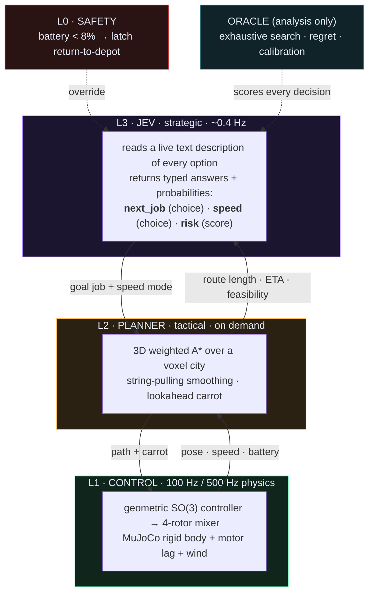

<div align="center">

# Jev Hierarchical Planner

**A language-grounded decision model flies a drone: Jev decides *what to do*, an A\* planner decides *where to fly*, and a physics-based controller decides *how to fly it*.**


-b388ff?style=flat-square)


*Live run, seed 0 (first 34 s). Left: the city, the A\* route (cyan), the goal beacon (purple), a storm cell and a no-fly zone (red).
Right: Jev's calibrated job probabilities (L3), the planner map (L2), flight telemetry (L1). Full video: [`docs/demo.mp4`](docs/demo.mp4)*

</div>

---

## Contents
[Architecture](#architecture) · [The math](#the-math) · [Results](#results) · [What the analytics found](#what-the-analytics-found-v1--v2) · [Run it](#run-it) · [Layout](#layout) · [Caveats](#caveats)

---

## Architecture



| layer | rate | decides | code |
|---|---|---|---|
| **L3 Jev** | ~0.4 Hz, ~0.35 s/call | *which job next*, speed mode, mission risk | [`strategist.py`](jevplanner/strategist.py) |
| **L2 planner** | on demand, ~60 ms | the 3D route through towers, canyons, ceiling, no-fly zones | [`planner.py`](jevplanner/planner.py) |
| **L1 control** | 100 Hz ctrl / 500 Hz physics | rotor thrusts that track the route | [`physics.py`](jevplanner/physics.py) |
| **L0 safety** | every tick | forces "return to depot" at low battery | [`mission.py`](jevplanner/mission.py) |

Jev never writes prose. Every ~2.5 s it gets a text description of the world and **three typed questions**, and answers with a probability per option:

```text
next_job : choice  options are rebuilt each call from the planner's live numbers, e.g.
           "Deliver URGENT medical supplies to the Clinic. Planned route 141 m, ETA 27 s, uses ~47% battery,
            leaving ~32%; a further ~38% is then needed to fly home. HARD DEADLINE in 31 s."
speed    : choice  eco | normal | urgent
risk     : score   low | moderate | high | critical
```

The planner prices every candidate goal and feeds route length, ETA and battery cost back into Jev's prompt, so the layers form a closed loop:
**Jev picks goals, the planner prices them.**

---

## The math

<details open>
<summary><b>L2 · Planning: weighted A\* on a voxel city</b></summary>

The world is a grid with resolution $r = 2\,\text{m}$. A voxel $v=(x,y,z)$ is **blocked** if it lies inside a building footprint inflated by a margin $m = 2.5\,\text{m}$ (and $2\,\text{m}$ vertically), below the ground clearance level, or inside an active no-fly cylinder:

$$
\text{blocked}(v) \;=\; \bigvee_{b}\Big[\,|x-c^b_x| < h^b_x + m \;\wedge\; |y-c^b_y| < h^b_y + m \;\wedge\; z < H_b + 2\,\Big] \;\vee\; \bigvee_{k \,\in\, \text{active}} \Big[(x-c^k_x)^2 + (y-c^k_y)^2 < (R_k + m)^2\Big]
$$

Moving between neighbouring voxels (26-connected) costs distance with vertical motion weighted $1.6\times$, plus a penalty for hugging obstacles:

$$
c(u \to v) \;=\; r\sqrt{\Delta x^2 + \Delta y^2 + (1.6\,\Delta z)^2} \;+\; 0.7\,r\cdot\mathbf 1[v \in \text{near-obstacle}]
$$

The search uses an inflated heuristic, so it is **weighted A\*** with $w = 1.25$:

$$
f(v) = g(v) + w\,h(v), \qquad h(v) = r\sqrt{\Delta x^2 + \Delta y^2 + (1.6\,\Delta z)^2}, \qquad \text{cost}(\text{path}) \le w \cdot \text{cost}^\*
$$

Waypoints are then **string-pulled** (greedy line-of-sight shortcuts), and the follower tracks a carrot point a distance $\ell = \text{clip}(0.6\,v_\text{mode},\,3,\,6)$ m ahead of the drone's projection on the path, with a braking speed limit that brings it to rest at the goal ($d$ = remaining path length):

$$
v_\text{lim} = \min\!\big(v_\text{mode},\; \sqrt{2 \cdot 1.4 \cdot d} + 0.7\big)
$$
</details>

<details open>
<summary><b>L1 · Control: geometric position / attitude controller on SO(3)</b></summary>

Position error is clipped so the commanded speed saturates at $v_\text{lim}$, then a PD law gives a desired acceleration (tilt limited to $38^\circ$):

$$
\mathbf a = K_p\,\text{clip}(\mathbf e,\; v_\text{lim} K_d / K_p) \;-\; K_d\,\mathbf v, \qquad
\mathbf a_\text{des} = \mathbf a + g\,\mathbf e_3, \qquad
\|\mathbf a_{xy}\| \le g\tan 38^\circ
$$

The thrust direction defines the desired attitude $R_d = [\mathbf x_b\;\mathbf y_b\;\mathbf z_b]$ with $\mathbf z_b = \mathbf a_\text{des}/\|\mathbf a_\text{des}\|$. Collective thrust and body torque follow the standard SO(3) controller:

$$
T = m\,\mathbf a_\text{des}\!\cdot\!R\,\mathbf e_3, \qquad
\mathbf e_R = \tfrac12\big(R_d^\top R - R^\top R_d\big)^{\vee}, \qquad
\boldsymbol\tau = J\big(-K_R\,\mathbf e_R - K_\omega\,\boldsymbol\omega\big) + \boldsymbol\omega \times J\boldsymbol\omega
$$

An X-configuration mixer allocates thrust and torque to the four rotors (arm $d = 0.2$ m, yaw coefficient $k = 0.016$), and each rotor responds with first-order motor lag ($\tau_m = 30$ ms):

$$
\begin{bmatrix} T \\ \tau_x \\ \tau_y \\ \tau_z \end{bmatrix} =
\begin{bmatrix} 1 & 1 & 1 & 1 \\ y_1 & y_2 & y_3 & y_4 \\ -x_1 & -x_2 & -x_3 & -x_4 \\ s_1 k & s_2 k & s_3 k & s_4 k \end{bmatrix}
\begin{bmatrix} f_1 \\ f_2 \\ f_3 \\ f_4 \end{bmatrix}, \qquad
\dot f_i = \frac{f_i^\text{cmd} - f_i}{\tau_m}, \quad f_i \in [0,\,8]\ \text{N}
$$

Gains: $K_p = 6,\; K_d = 4,\; K_R = 60,\; K_\omega = 10$. Physics runs at 500 Hz, the controller at 100 Hz.
</details>

<details open>
<summary><b>Battery model and the feasibility rule Jev is asked to respect</b></summary>

Battery drains in proportion to total rotor thrust (≈ 1.5 %/s hovering, since $\sum f_i \approx mg \approx 14.7$ N):

$$
\dot B = -0.105 \sum_{i=1}^{4} f_i \quad [\%/\text{s}]
$$

For decision-making, a leg of planned length $L$ is priced as $\text{ETA} = L/6 + 3$ s and $\text{need} = 1.75 \cdot \text{ETA}$ percent. A job $j$ is **feasible** only if it leaves enough to fly home plus a reserve:

$$
B \;-\; \text{need}(j) \;-\; \text{home}(j) \;\ge\; 10\,\%
$$

where $\text{home}(j)$ is the planner's own cost of the route from the job back to the depot. L0 overrides everything and latches "return to depot" if $B < 8\%$.
</details>

<details>
<summary><b>Oracle, regret and calibration (how decisions are scored)</b></summary>

For the $n$ remaining jobs, the oracle enumerates every ordering $\pi$ (with optional recharge stops) and finds the fastest feasible plan:

$$
T^\* = \min_{\pi \in S_n,\; \text{recharge}} T(\pi) \quad \text{s.t. battery and deadline constraints}
$$

A dispatcher that picks first job $c$ has **regret** $\;\rho(c) = T^\*(\text{first}=c) - T^\*$ (seconds lost; capped, plus a penalty if $c$ admits no feasible plan), and "agrees" with the oracle if $c$ is optimal or $\rho < 0.75$ s.

Jev returns a probability $p_i$ for its chosen job. Calibration is measured over $N$ decisions with outcomes $y_i = \mathbf 1[\text{agree}]$, binned into $B$ confidence bins:

$$
\text{ECE} = \sum_{b=1}^{B} \frac{n_b}{N}\,\big|\,\text{acc}_b - \text{conf}_b\,\big|, \qquad
\text{Brier} = \frac1N \sum_{i=1}^{N} (p_i - y_i)^2
$$

Success rates carry 95 % **Wilson** intervals, and paired comparisons use an exact two-sided **sign test**:

$$
\tilde p \,\pm\, \frac{z\sqrt{\hat p(1-\hat p)/n + z^2/4n^2}}{1 + z^2/n}, \quad \tilde p = \frac{\hat p + z^2/2n}{1+z^2/n}; \qquad
p_\text{sign} = \min\!\Big(1,\; 2\sum_{i=0}^{k}\binom{n}{i}2^{-n}\Big),\; k = \min(\text{wins},\text{losses})
$$
</details>

---

## Results

> ### TLDR
>
> - **The hierarchy works.** Across 24 held-out randomised city missions, Jev (as strategic layer) **delivered all 4 packages and landed in 23/24**; a greedy dispatcher with no battery look-ahead completed **0/24**.
> - **Jev is *not* better than a competent hand-written dispatcher here.** The rules baseline (given the *same* numbers Jev sees) went **24/24**, agreed with the oracle slightly more often (**89% vs 86%**, not significance-tested) and was **~8.5 s faster** per mission. The honest claim is "Jev matches a hand-engineered policy while being specified in a sentence of language, not code."
> - **Jev's confidence is trustworthy.** Its stated probabilities roughly track how often it matches the exhaustive-search oracle (**ECE 0.061**), with some overconfidence in the 0.95-0.99 bin (about 80% agreement).
> - **The planner and a battery-aware strategist clearly earn their place; L0 is untested here.** Without the planner the drone "succeeds" 24/24 *but flies through buildings for 27.5 s per mission* (0/24 clean). A strategist with no battery look-ahead (greedy) runs out of power every time. The L0 supervisor never triggered, so these runs say nothing about its value.
> - **Analytics caught a real bug.** v1 scored 21/24 because my prompt ranked the deadline above battery safety. After fixing it, a re-run on **different, held-out seeds** scored 23/24. Different seeds means this is not a controlled before/after (see below).
> - **Cheap.** About **$0.0016 per mission**, $0.197 for both full campaigns (5,727 Jev calls). No GPU needed.

Randomised missions: storm and no-fly timing/size/position, medical deadline, start battery 72-100 %, wind. Every configuration flies the **same** scenario for a given seed. Seeds 25-48 are **held out**: they were not looked at while the prompt was being fixed. (Seed 0 is the demo scenario used during development and is not part of any statistic.)

| term | meaning |
|---|---|
| **success** | all 4 deliveries made **and** the drone landed at the depot without running out of battery |
| **clean success** | success **and** never inside a building and under 2 s inside a no-fly zone (zones can appear around the drone) |
| **oracle agreement** | fraction of decisions where the chosen first job is optimal under exhaustive search (or within 0.75 s of it) |
| **regret** | seconds lost versus the oracle's best plan for the chosen first job (capped; extra penalty if it admits no feasible plan) |

| configuration | success | clean success* | deadline met | time (s) | oracle agreement | mean regret | $ / mission |
|---|---|---|---|---|---|---|---|
| **Jev hierarchy (L0-L3)** | 23/24 (96 %) | 19/24 | 22/24 | 139 | 86 % | 8.2 s | $0.0016 |
| Rule-based dispatcher | 24/24 (100 %) | 20/24 | 22/24 | 129 | 89 % | 1.9 s | - |
| Greedy dispatcher | **0/24** | 0/24 | 24/24 | - | 62 % | 36.3 s | - |
| Jev, **no A\* planner** | 24/24 | **0/24** | 24/24 | 106 | - | - | $0.0012 |
| Jev, no L0 safety | 23/24 | 19/24 | 22/24 | 138 | 85 % | 8.5 s | $0.0016 |

<sub>*clean = all delivered, landed, never inside a building, under 2 s inside a no-fly zone. Intervals and paired tests: [`docs/RESULTS.md`](docs/RESULTS.md).</sub>

<div align="center">

</div>

### Reading the figure
<table>
<tr><td width="50%">

**Success and safety**
- *Success (light) vs clean success (solid)* separates "finished" from "finished without cheating". The no-planner ablation is the big gap.
- *Airspace violations* shows that exact cheat: 27.5 s inside buildings and 7.3 s in no-fly zones.
- *Lowest battery* shows the safety margin each policy leaves; greedy hits 0 %.

</td><td width="50%">

**Judgment quality**
- *Oracle agreement / regret* scores each decision against exhaustive search.
- *Calibration* is the reliability diagram: points on the dashed diagonal mean "confidence = accuracy".
- *Regret CDF*: most decisions cost 0 s; the tail is where Jev loses time.

</td></tr>
</table>

### What the numbers say (and don't)

- **Jev vs rules:** success is a statistical tie (23/24 vs 24/24; sign test $p = 1.0$). On the 23 seeds both finished, Jev was slower in 20, faster in 1: mean $-8.5$ s (95 % CI $-15.8$ to $-1.8$ s).
- **It never uses the `urgent` speed mode**, even on the two seeds that missed the deadline (seed 30 was missed by both Jev and rules; on seed 31 only Jev was late, by 2.2 s). A real gap in how it trades battery against time.
- **L0 is a null result.** It never triggered in Jev's runs, and the one Jev crash (seed 35) happened with L0 on: an 8 % trip level is too late when the drone is far from the depot. A distance-aware trip level would be the fix.

---

## What the analytics found (v1 &rarr; v2)

<table>
<tr><th></th><th>v1 (seeds 1-24)</th><th>v2 (seeds 25-48, held out)</th></tr>
<tr><td><b>Prompt priority</b></td><td>1. hard-deadline delivery &nbsp; 2. battery</td><td>1. <b>battery safety (hard constraint)</b> &nbsp; 2. deadline</td></tr>
<tr><td><b>Jev success</b></td><td>21/24 (88 %)</td><td>23/24 (96 %)</td></tr>
<tr><td><b>Rules success</b></td><td>23/24 (96 %)</td><td>24/24 (100 %)</td></tr>
<tr><td><b>Jev calibration (ECE)</b></td><td>0.128</td><td>0.061</td></tr>
</table>

All three v1 Jev failures had the same shape: a low start battery (~79 %), Jev flew the urgent medical run to the far corner, and died before it could get home. The cause was my prompt, not the model: it listed the deadline as priority 1 and battery as priority 2, and Jev followed it. I made battery safety a hard constraint and re-evaluated on **fresh seeds** rather than the same ones, so the fix is not tuned on its own test set. v1 is archived in [`docs/v1/`](docs/v1/).

> **Read this table as direction, not effect size.** v1 and v2 use different scenarios, so the numbers are not a controlled before/after: the rules baseline also moved from 96 % to 100 % purely from the scenario draw, and the ECE change could come from the seeds as much as from the prompt. The stronger evidence is qualitative: all three v1 failures had one identical cause that traces directly to the prompt wording. A controlled test (re-running the fixed prompt on seeds 1-24) was not done.

---

## Run it

```bash
python -m venv .venv && .venv/Scripts/pip install -r requirements.txt      # Windows; .venv/bin/ on Linux
echo OPENROUTER_API_KEY=sk-or-... > .env      # .env is git-ignored; never commit it

python run_demo.py                  # live Jev, seed 0 -> out/demo.mp4 + out/summary.png + out/decision_log.json
python run_demo.py --policy rules   # offline hand-written dispatcher
python rollout.py --seeds 1-24 --workers 6     # Monte-Carlo (resumable, one JSON per rollout)
python analyze.py                   # -> docs/analysis.png, docs/RESULTS.md
```

One Jev call (3 typed questions) is about **$0.000035** and ~0.35 s; a mission is ~45 calls = **$0.0016**. Each 120-rollout campaign (72 Jev missions) cost about $0.10.
Rollouts are CPU/API bound: **a GPU is not used**. On a Linux VM: `bash scripts/vm_rollout.sh 1-96 8` (finished rollouts are skipped, so spot pre-emption is harmless).

## Layout

```text
jevplanner/   world.py (city, jobs, zones)      planner.py (A*)          physics.py (MuJoCo + controller)
              strategist.py (Jev + baselines)   oracle.py (search)       scenario.py   mission.py   hud.py
run_demo.py   rollout.py   analyze.py   scripts/
docs/         demo.mp4  analysis.png  RESULTS.md  architecture.png  v1/
```

## Caveats

Simulation only. Buildings are visual: the physics has no collisions, so building clearance is *measured*, not enforced. The battery model is a simple thrust-proportional drain. Jev is reached through an alpha endpoint (`typesafe/jev-1.13`) that may change, and each call sends the mission's text state to OpenRouter / TypeSafe AI. This is an independent project, not affiliated with or endorsed by TypeSafe AI or OpenRouter. The oracle uses Jev's own cost model, so it scores judgment, not the accuracy of the model itself. 24 scenarios give wide confidence intervals; differences of a task or two are noise.
